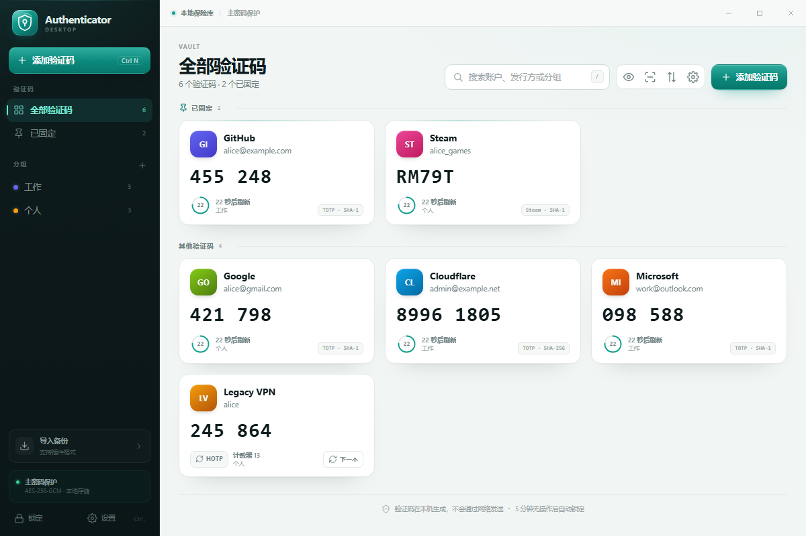
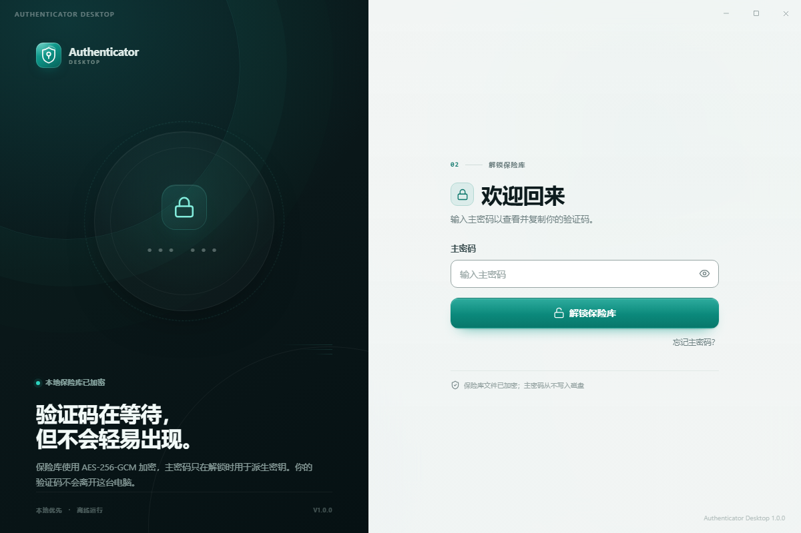
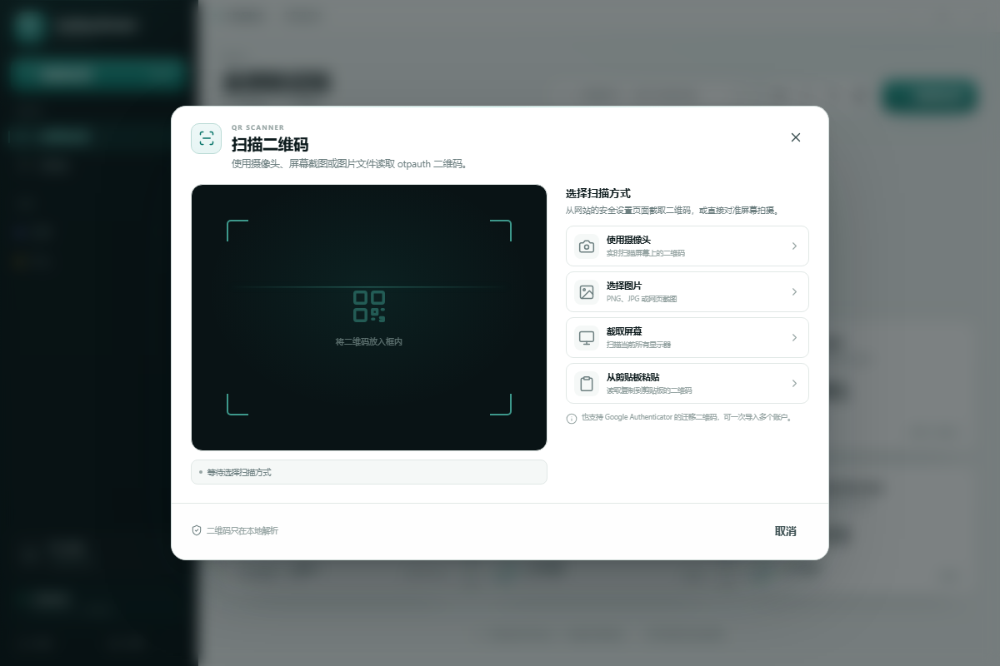
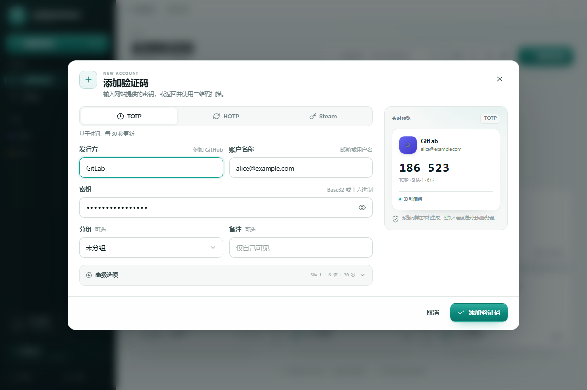
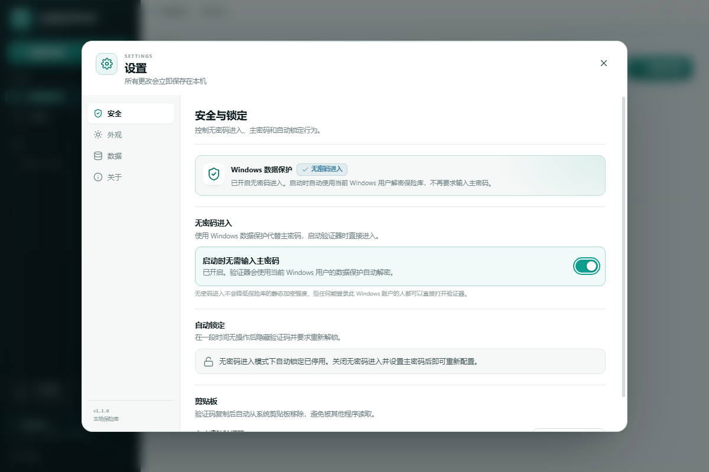
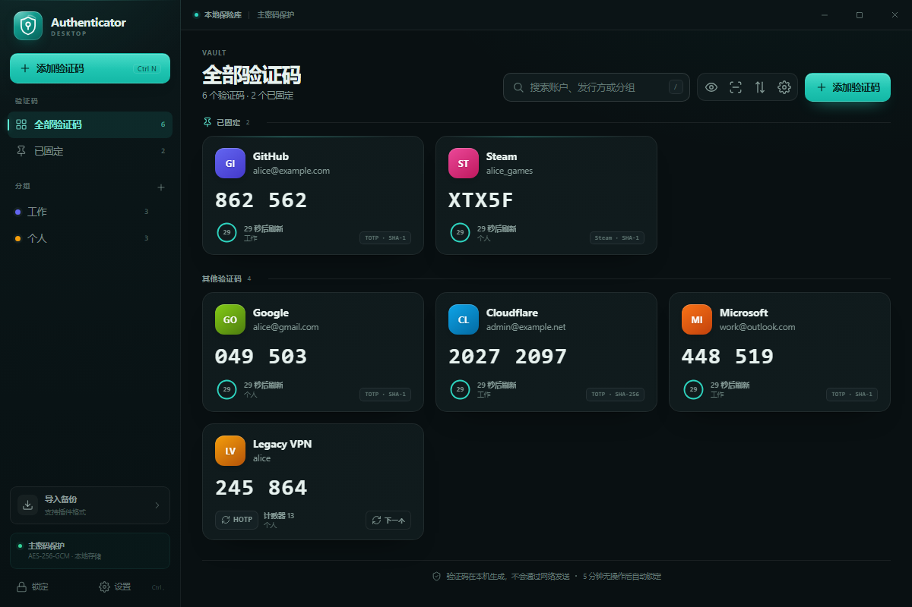
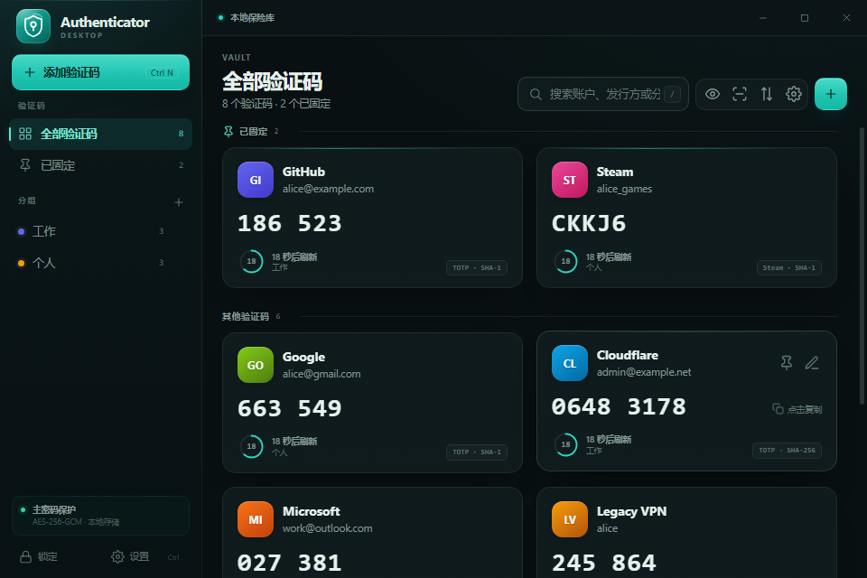
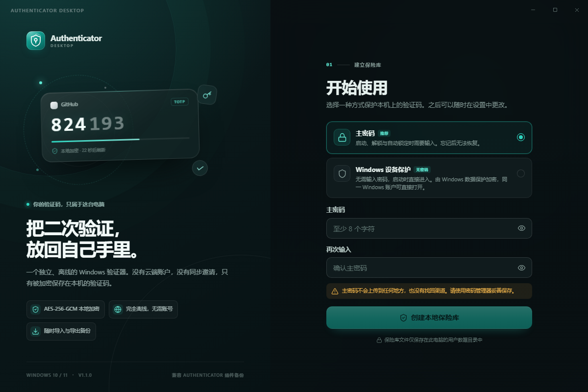

# Authenticator Desktop

一个独立、离线的 Windows 桌面二次验证应用。它把浏览器插件中与验证码相关的核心体验带到了桌面：本地加密保险库、二维码扫描、TOTP / HOTP / Steam、分组与搜索，以及兼容 Authenticator 浏览器插件的导入导出。

> 不依赖浏览器、不需要账号、不上传验证码。所有密钥都只保存在你的电脑上。



## 功能

### 验证码

- 标准 **TOTP**（SHA-1 / SHA-256 / SHA-512，6–10 位，自定义周期）
- **HOTP**（手动递增计数器）
- **Steam Guard** 五码
- 实时倒计时、临近过期提醒、一键复制
- 隐藏全部验证码（防窥屏）、固定常用账户、搜索、分组、拖动排序

### 添加与迁移

- 手动输入密钥
- 摄像头实时扫描二维码
- 从图片文件、屏幕截图或剪贴板图片识别二维码
- Google Authenticator 批量迁移二维码
- 导入 Authenticator 浏览器插件的备份：
  - 明文 JSON
  - 加密 JSON（v1 / v2 / v3，使用插件原密码解密）
  - otpauth 文本
- 导出四种格式：
  - 加密备份（AES-256-GCM，可放入网盘）
  - 明文 JSON
  - 插件兼容 JSON
  - otpauth 文本
- 导入时自动跳过重复账户；应用备份会恢复分组及成员关系

### 桌面体验

- **无密码进入**：可选使用 Windows DPAPI 设备保护，启动时无需输入主密码
- 主密码保护，或使用 Windows DPAPI 的设备保护模式
- 自动锁定、最小化锁定、系统锁屏/休眠时锁定（主密码模式）
- 复制验证码后自动清空系统剪贴板（默认 30 秒，可关闭）
- 浅色 / 深色 / 跟随系统主题，紧凑布局
- 全局快捷键 `Ctrl+Shift+A` 唤起窗口
- 系统托盘、窗口标题栏集成、单实例运行
- 支持便携模式：数据保存在可执行文件旁边

## 截图

| 解锁 | 扫描二维码 |
| --- | --- |
|  |  |

| 添加账户 | 设置：无密码进入 |
| --- | --- |
|  |  |

| 深色主题 | 960 × 640 窄窗口 |
| --- | --- |
|  |  |

## 安装与运行

在交付包的 `release/` 目录中取得：

- `Authenticator-Desktop-Setup-1.1.0.exe` —— 安装版，创建桌面和开始菜单快捷方式
- `Authenticator-Desktop-1.1.0-Portable.exe` —— 便携版，无需安装

安装包未使用商业代码签名证书。Windows SmartScreen 可能显示“未知发布者”，请选择“更多信息 → 仍要运行”，或在运行前核对文件哈希。

### 数据保存在哪里

| 模式 | 位置 |
| --- | --- |
| 安装版 | `%APPDATA%\Authenticator Desktop\vault.json` |
| 便携版 | 可执行文件旁边 `AuthenticatorDesktopData\vault.json` |

保险库文件以认证加密形式写入，旁边会自动保留一份 `vault.backup.json`。不要手工编辑这些文件。

### 首次使用



1. 选择“主密码”或“Windows 设备保护（无密码进入）”。
2. 主密码至少 8 个字符，**无法找回**。请使用密码管理器保存。
3. 通过二维码或手动密钥添加账户。
4. 立刻导出一份加密备份，并存放在另一台设备或可信位置。

## 安全设计

- 主密码通过 **scrypt**（N=32768, r=8, p=1，随机 16 字节盐）派生 256 位密钥。
- 保险库使用 **AES-256-GCM** 加密，随机 96 位 IV 和认证标签。
- 密钥只存在于 Electron 主进程内存中；界面进程通过受控 IPC 获取验证码和必要的账户信息，无法直接读取保险库文件。
- 渲染进程启用 `contextIsolation`、`sandbox`，关闭 `nodeIntegration`，并设置严格 CSP。
- 应用默认不发起外部网络请求，不包含遥测、分析或云同步。
- 文件写入采用临时文件 + 原子重命名，并保留上一版本自动备份。
- 连续输错主密码会触发逐步延迟；锁定时会清除由应用复制的剪贴板验证码。
- Windows 设备保护模式使用 Electron `safeStorage`（Windows DPAPI），加密数据绑定当前 Windows 用户。
- **无密码进入**可在设置中开启：验证器启动时自动使用当前 Windows 用户的 DPAPI 解密保险库，不再显示主密码输入界面。它不会削弱静态加密，但安全性取决于 Windows 账户本身的登录保护。

### 限制与提醒

- 主密码、Windows 账户和备份密码都无法找回。忘记主密码且没有备份时，数据无法恢复。
- 本应用是独立的开源实现，**未经过正式安全审计**。请像对待其他密码管理器一样评估风险。
- 使用无密码进入时，任何能登录当前 Windows 账户的人都能直接打开应用。请确保 Windows 账户有登录密码或 Windows Hello 保护。
- 无密码进入模式下自动锁定不可用；如需自动锁定，请在设置中设置主密码并关闭无密码进入。
- 不支持 GOST 哈希；极少数 Battle.net 历史条目会作为 8 位 TOTP 导入。标准 Battle.net 验证器通常并非标准 TOTP，无法保证兼容。
- 浏览器插件中的网页自动填充、浏览器云同步、Drive/Dropbox/OneDrive 备份等功能与浏览器环境绑定，桌面版不提供；请使用本地加密备份迁移和恢复。
- 验证码基于系统时间生成。请确保 Windows 时间同步正常。

## 快捷键

| 快捷键 | 功能 |
| --- | --- |
| `Ctrl+K` 或 `/` | 搜索 |
| `Ctrl+N` | 添加验证码 |
| `Ctrl+,` | 设置 |
| `Ctrl+L` | 锁定保险库（主密码模式） |
| `Ctrl+Shift+A` | 全局唤起窗口 |
| `Esc` | 关闭弹窗 / 清除搜索焦点 |

## 从 Authenticator 浏览器插件迁移

1. 在浏览器插件中：设置 → 备份 → 下载备份文件。
2. 在桌面版：左下角“导入备份” → 选择下载的 `.json` / `.txt`。
3. 如果是插件加密备份，输入**创建备份时使用的插件密码**（不是桌面版主密码）。
4. 确认预览中的账户，选择目标分组并导入。

支持的插件备份包括：

- 明文 `OTPStorage` JSON
- v1：`encrypted: true` 的 `secret`
- v2：顶层 `key.enc` + `EncOTPStorage`
- v3：`Key.salt` / `Key.hash` + Argon2id + `EncOTPStorage`

插件专有的 Steam `stm-` 前缀和 Battle.net `blz-` 前缀也会被识别。

## 从源码构建

要求：Windows 10/11、Node.js 20+、pnpm。

```powershell
pnpm install
pnpm test             # OTP、备份、加密与导入测试
pnpm build:renderer   # 构建界面
pnpm dist             # 生成 NSIS 安装包与便携版
```

产物位于 `release/`。

开发模式：

```powershell
pnpm dev
# 另一个终端
$env:VITE_DEV_SERVER_URL = "http://127.0.0.1:5173"
pnpm start
```

### 测试

`pnpm test` 会运行：

- RFC 4226 HOTP 测试向量
- RFC 6238 TOTP SHA-1 / SHA-256 / SHA-512 测试向量
- Base32 往返、otpauth URI、Google 迁移 protobuf
- 保险库初始化、错误密码、改密、锁定、重置
- 应用加密备份、插件明文/v1/v2/v3 加密备份导入
- Steam 前缀、分组恢复、重复检测

端到端冒烟测试可在已构建的界面和临时数据目录上运行：

```powershell
pnpm smoke
```

## 目录结构

```
electron/            主进程、IPC、保险库、OTP 与备份引擎
src/                 React 渲染界面
  components/        共享组件、账户卡片、窗口控件
  components/modals/ 添加、扫描、导入、导出、设置、分组
  screens/           首次设置与解锁
  styles/            设计令牌与界面样式
tests/               协议与保险库测试
build/               图标等安装包资源
```

## 兼容与致谢

- 兼容 [Authenticator-Extension/Authenticator](https://github.com/Authenticator-Extension/Authenticator)（MIT）的账户与备份格式。本项目没有复制或再分发该插件的源代码。
- 原浏览器插件源码完整保留在 [`browser-extension`](https://github.com/wangtianqin/Authenticator-desktop/tree/browser-extension) 分支，供对照与继续使用。
- 核心 OTP 协议遵循 RFC 4226 / RFC 6238；Steam Guard 使用 Steam 的公开字母表算法。
- 依赖与许可证见 [THIRD_PARTY_NOTICES.md](THIRD_PARTY_NOTICES.md)。

## 许可证

本项目以 MIT 许可证发布，见 [LICENSE.txt](LICENSE.txt)。
